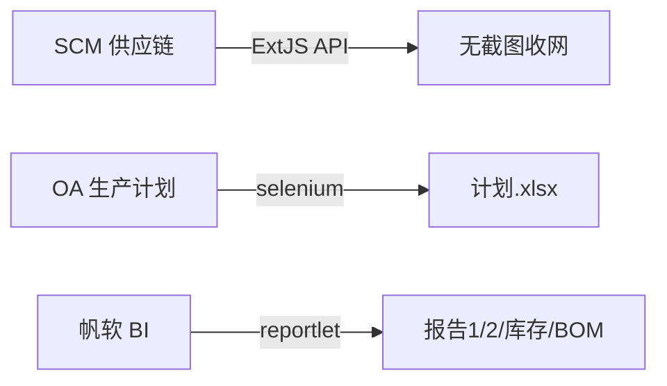

# 🧰 OpenClaw 技能工具箱

## 简介

本工具包将以下 **4 个实用技能** 整合在一起，可通过统一的 `tools/skills.py` 脚本执行：

| # | 技能名称 | 图标 | 触发词 |
|---|----------|------|--------|
| 1 | **产销存报表 & 跑回货工具** | 📊 | `产销存报表`, `跑回货工具` |
| 2 | **惠而浦物料查询工具** | 📋 | `查料号` |
| 3 | **SCM 回货计划导入 & 发放** | 📦 | `回货`, `huihuo`, `回货计划`, `帮我回货` |
| 4 | **惠而浦统一报表下载器** | 📊 | `报表下载`, `whirlpool 下载`, `SCM 下载` |

---

## 安装方式

### 方式一：一键安装（推荐）

```bash
# 一次性从本地目录安装所有 4 个技能到 ~/.codex/skills/
python tools/install_skill.py --path ./skills
```

> 💡 如果已配置 `.openclaw` 环境，会自动将技能复制到 `$HOME/.codex/skills/`（Bionic）或 `~/.openclaw/skills`（OpenClaw）。

### 方式二：从 GitHub 安装（支持私有仓库）

```bash
# SCM 回货导入工具（含私有配置）
python tools/install_skill.py \
    --repo "openai/skills" \
    --path "skills/.curated/WHP-scm-huihuo-import"

# 惠而浦报表下载器
python tools/install_skill.py \
    --repo "openai/skills" \
    --path "skills/.curated/WHP-whirlpool-download"
```

### 方式三：手动安装（跳过此步，手动复制）

将 `E:/SKILLS/tools/skills` 目录下的内容复制到 `$HOME/.codex/skills/` 或 `$HOME/.openclaw/workspace/skills/`。

---

## 使用方法

```bash
# ==================== 一键查看所有技能 ====================
python tools/skills.py --list


# ==================== 产销存报表（转译版优先，失败自动回退） ====================
python tools/skills.py --trigger "产销存报表"


# ==================== 跑回货工具 ====================
python tools/skills.py --trigger "跑回货工具"


# ==================== 惠而浦物料查询 ====================
python tools/skills.py --trigger "查料号 ST1TN40100SE-"


# ==================== SCM 回货导入 & 发放 ====================
# 单条模式：
python tools/skills.py --trigger "帮我回货 70C012345 5"

# 多行批量（逗号分隔）:
python tools/skills.py --trigger "帮我回货 70C11099 2, ABC 3 紧急补货"

# 无头模式（后台静默，不显示浏览器窗口）:
python tools/skills.py --trigger "无头回货 70C012345 5"


# ==================== 惠而浦统一报表下载 ====================
# 全量下载：SCM + OA + 帆软
python tools/skills.py --trigger "报表下载"

# 只下载 SCM（优化版，无截图 + 齐射收网）:
python tools/skills.py --trigger "SCM 下载"

# 只下载 OA 生产计划:
python tools/skills.py --trigger "OA 下载"

# 只下载帆软报表：
python tools/skills.py --trigger "帆软下载"
```

---

## 依赖检查

运行前请确保已安装必要依赖：

```bash
pip install playwright pandas openpyxl ddddocr cryptography lxml
playwright install chromium msedge
```

| 技能 | Python 包 | 额外需求 |
|-----|----------|---------|
| **产销存报表** | `win32com`, `openpyxl` | Windows + Excel VBA 宏支持 |
| **物料查询** | `openpyxl` | — |
| **SCM 回货导入** | `playwright`, `ddddocr`, `cryptography` | Edge 浏览器（msedge） |
| **报表下载器** | `playwright`, `pandas`, `lxml` | Edge 浏览器 + 浏览器 profile |

---

## 原理说明

### 🔄 转译版优先策略

| 技能 | 优先执行层 | 回退机制 |
|------|-----------|----------|
| 产销存报表 | `transpiled_inventory.py` (openpyxl+COM, 无 Excel 进程依赖) | → `inventory_daily_report.py` (原脚本，含 VBA COM 引用) |

**优势：**
- 转译版不需要启动 Excel 进程 → **不占用系统资源**、**不影响其他用户操作**
- 失败时自动降级到外部脚本模式（带 `win32com` + `openpyxl` 双保险）

### 🧠 SCM 回货导入：直通批量模式

```python
# 用户输入: "帮我回货 70C012345 5"
# ┌─────────────┐     ┌──────────────┐
# │ 1.登录SCM   │ →   │ 2.新增回货行 │ → 保存审核
# └─────────────┘     └──────────────┘
#                                    ↓
#                            3.筛选全选 → 批量发放
```

**v2.2 优化：**
- ✅ 支持多行一次性导入（逗号分隔或换行）
- ✅ `--headless` 无头模式，后台静默执行
- ✅ 失败不中断后续行（容错模式）
- ✅ JSON + 日志双输出，便于调试

### 📊 报表下载器：三大系统自动化



**核心优化：**
- **SCM 模块**：使用 `ExtJS API` 直接提取 Grid 数据，不截图 → 速度提升 ~3x
- **密码管理**：AES-256 加密存储于 `secure_config.py`
- **浏览器隔离**：每个系统独立 profile，互不影响

---

## 日志与调试

所有技能均记录详细日志：

```bash
# SCM 回货导入会生成日志文件
tail -f E:/SKILLS/.openclaw/workspace/skills/WHP-scm-huihuo-import/logs/scm_huihuo.log

# 报表下载器日志
tail -f E:/SKILLS/.openclaw/workspace/skills/WHP-whirlpool-download/logs/unified_report_downloader.log
```

---

## 架构概览

```
E:/SKILLS/tools/
├── install_skill.py       ← Bionic/OpenClaw 技能安装器（入口脚本）
└── skills.py              ← 统一调度引擎，支持触发词路由 + 依赖检查

[本地技能仓库]
├── reporting-tools/         → 📊 产销存报表 & 跑回货工具
│   ├── openclaw.json       # 元数据（触发词、依赖等）
│   └── scripts/
│       ├── transpiled_*.py  ← 转译版：openpyxl + COM
│       └── inventory_daily_report.py      ← 回退脚本（win32com+openpyxl）
├── material-inventory-check/ → 📋 惠而浦物料查询工具
│   ├── openclaw.json
│   └── scripts/query.py
├── WHP-scm-huihuo-import/      → 📦 SCM 回货计划导入 & 发放
│   ├── openclaw.json
│   ├── run.js               ← Node.js 入口
│   ├── huihuo_scm.py       ← Playwright + OCR
│   └── secure_config.py    ← AES-256 密码加密
└── WHP-whirlpool-download/      → 📊 统一报表下载器
    ├── openclaw.json
    ├── unified_report_downloader.py  ← 三大系统自动化
    ├── run.js                    ← Node.js 入口
    ├── secure_config.py          ← AES-256 加密
    └── scripts/                  # BOM 循环查询等辅助脚本
```

---

## 故障排查

| 现象 | 可能原因 | 解决方法 |
|------|---------|---------|
| `技能依赖缺失` | Python/bin/python 未识别 | 检查 `python --version`，确保是目标环境 |
| `Node.js 命令不存在` | Node.js 未安装或 PATH 未配置 | `npm install -g playwright` 或直接运行脚本 |
| `SCM 登录失败` | 账号密码错误 / Cookie过期 | 使用 `secure_config.py` 更新加密密码 |
| `Playwright 启动失败` | msedge/Chrome 浏览器版本过旧 | `playwright install chromium msedge` |
| `OpenCLaw 无法识别技能` | `.codex/skills` 目录未同步 | 重启 IDE / 重新读取配置 |

---

## License

MIT — © QuDin (Whirlpool China Factory Automation)

> 💡 本工具包仅供内部使用，请遵守公司数据安全规范。